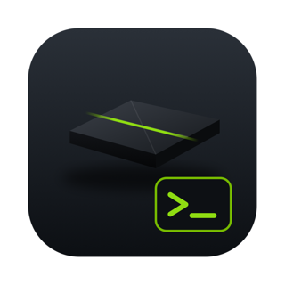

<p align="center"></p>

# nvidia-shield-sword

Turn an **NVIDIA Shield** (Android TV) into an always-on home for **Claude Code**, and steer it
from your phone through a **Telegram bot**. A small **macOS helper** (`shield` command +
`Shield.app`) gets you into the Shield over SSH with one click.

```
 Phone (Telegram) ──► @your_bot ──► Claude Code (tmux "claude") ──► web search, files in ~/workspace
                                        │
 Mac ── Shield.app / `shield` ── SSH ───┤  Debian (proot-distro) inside Termux on the Shield
                                        │
                             adb (network) wakes Termux after a reboot
```

- **No root needed**: Termux + a Debian container via `proot-distro`.
- **Uses your Claude subscription** (Pro/Max): sign in once, same quota as the Claude apps.
- **Telegram** via Claude Code's official [channels](https://code.claude.com/docs/en/channels)
  plugin, locked to your own account with an allowlist.
- **Restarts itself**: Claude is relaunched 15 s after any exit, so the bot stays online.
- **Workspace**: Claude works in `~/workspace` (recreated automatically if deleted).
  [`examples/trips`](examples/trips) adds rules for planning trips (proposes options with
  sources, never books or pays).

## Repository layout

| Path | What it is |
|---|---|
| `setup/install.sh` | Mac-side installer: Termux, SSH, Debian, Claude Code, Bun, autostart |
| `setup/termux-setup.sh`, `setup/debian-setup.sh` | Run on the Shield (piped over SSH by the installer) |
| `setup/lib/typeline.py` | Types the one-time SSH bootstrap command into Termux via `adb shell input text` |
| `shield/termux/` | `start-claude.sh` (starts sshd + Debian + Claude) and the `~/.bashrc` autostart hook |
| `examples/trips/` | Optional trip-planning setup for the workspace: `CLAUDE.md` rules + pre-allowed tools |
| `mac/` | `shield` command, `Shield.app` source (AppleScript + SVG icon), build and install scripts |
| `linux/` | Linux version of the helper: `shield`, a zenity/kdialog menu and a desktop launcher ([docs/LINUX.md](docs/LINUX.md)) |
| `config.example` | Settings (Shield IP, SSH key, time zone) |
| `docs/` | Guides |

## Quick start

1. Prepare the Shield and the Mac: **[docs/SETUP.md](docs/SETUP.md)** (ADB, SSH key, config).
2. `mac/install.sh` (installs the `shield` command, config and Shield.app). On Linux:
   `linux/install.sh`, see [docs/LINUX.md](docs/LINUX.md).
3. `setup/install.sh` (sets up everything on the Shield, about 15–30 minutes).
4. Sign in to Claude and connect Telegram: **[docs/TELEGRAM.md](docs/TELEGRAM.md)**.
5. Day-to-day use: **[docs/USAGE.md](docs/USAGE.md)**. Problems: **[docs/TROUBLESHOOTING.md](docs/TROUBLESHOOTING.md)**.

## Status

Every step was run and verified by hand on an NVIDIA Shield TV (Android 11) with a Mac
(macOS 15). The scripts codify those steps and were syntax-checked; the full `setup/install.sh`
run on a factory-fresh Shield has **not** been tested end to end yet. Each stage can be resumed
with `setup/install.sh --from <stage>`.

Channels are a Claude Code **research preview**: flags and behaviour may change.

## Safety notes

- Anyone who can message your bot **and** is on its allowlist can make Claude act on the Shield.
  Keep the allowlist to yourself and only pre-allow tools you are comfortable running unattended.
- The workspace rules tell Claude never to pay, book, or handle passwords/cards. Treat that as a
  guideline, not a security boundary.
- Termux's sshd accepts key logins from your home network. Don't forward port 8022 on your router.
- Not affiliated with or endorsed by NVIDIA. "NVIDIA" and "SHIELD" are trademarks of NVIDIA
  Corporation; the icon is an original drawing.

## License

MIT, see [LICENSE](LICENSE).
