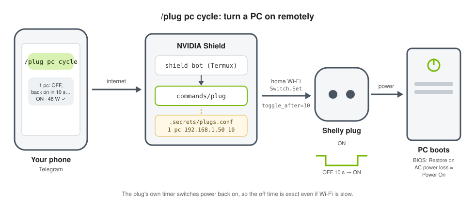

# Examples

Ready-made bot commands and extra rules for Claude's workspace on the Shield
(`/root/workspace` in Debian).

## trips

Plan trips from Telegram: Claude asks for what's missing, researches schedules and prices on
the web, proposes 2–3 numbered options with sources and booking links, and **never books, pays
or handles passwords/cards**. The workspace's default tool permissions (web search, web pages,
files, shell) already cover it.

Append it to the workspace rules from your Mac (repository folder):

```bash
source ~/.config/shield/config
ssh -p "$SHIELD_SSH_PORT" -i "$SHIELD_SSH_KEY" "$SHIELD_HOST" \
  'proot-distro login debian -- bash -c "printf \"\n\" >> /root/workspace/CLAUDE.md && cat >> /root/workspace/CLAUDE.md"' \
  < examples/trips/CLAUDE.md
```

Claude reads `CLAUDE.md` on every request, so it applies to the next Telegram message.
Send `/new` first if the current conversation should forget earlier context.

## commands/plug: Shelly smart plugs



Controls one or more Shelly plugs on your Wi-Fi directly over their local API (Gen2/Gen3/Gen4,
tested with a Shelly Plug S Gen3; no Shelly cloud):

| Command | What it does |
|---|---|
| `/plugs` | Status of all plugs, e.g. `1 pc: ON · 48.2 W · 38 °C · 1.24 kWh` |
| `/plug_pc` | Status of plug `pc` |
| `/plug_pc_on` · `/plug_pc_off` · `/plug_pc_toggle` | Switch plug `pc` |
| `/plug_pc_cycle` | **Power cycle**: off for the plug's cycle time (default 60 s), then on again |

These are generated **per plug** from `plugs.conf` (`pc` is the plug's name; a plug named `lamp`
gets `/plug_lamp_on`, …) and all appear in Telegram's command menu (the **/** button); a new
plug's entries appear within a minute. There are no commands with spaces: the underlying
`commands/plug` is *shortcuts-only*.

### Turning a PC on with `cycle`

A PC whose BIOS is set to power on when mains power returns can be started remotely by cutting
its power briefly. `cycle` uses the plug's **own timer** (`Switch.Set` with `toggle_after`): the
plug switches off and back on by itself after N seconds, so the off time is exact even if Wi-Fi
or the Shield is slow. A quick `off`/`on` or `toggle` from the phone is often too short for the
power supply to register a power loss. After the cycle, the reply shows the power draw: tens of
watts means the PC is booting.

The trick works with **most desktop PCs**: almost every motherboard can boot automatically when
mains power returns. Only the BIOS option names and the needed off time differ.

#### Adapting it to your PC

1. **Enable power-on after power loss.** Typical names (they vary by BIOS version; look in the
   power, ACPI, chipset or advanced menus):

   | Vendor | Typical option | Value |
   |---|---|---|
   | ASRock | Restore on AC/Power Loss | Power On |
   | ASUS | Restore AC Power Loss | Power On |
   | MSI | Restore after AC Power Loss | Power On |
   | Gigabyte | AC BACK | Always On |
   | Dell / HP / Lenovo (office PCs) | AC Recovery / After Power Loss / After Power Failure | Power On |

   Use *Power On* / *Always On*, not *Last State*: with *Last State*, a PC you shut down normally
   stays off.
2. **Disable deep power-saving modes** that can keep the board from noticing power returning:
   *Deep Sleep*, *ErP Ready*, *EuP*, *Deep S4/S5*.
3. **Optional:** disable USB power in the off state (*USB power in S5*, *USB standby power*) if you
   don't want USB devices powered while the PC is off; disable USB wake options then too.
4. **Find the off time.** Shut the PC down, set a cycle time in `plugs.conf` (fourth column:
   30, then 60, 90…), and send `/plug_pc_cycle` until the PC boots (the reply shows tens of
   watts when it does). Keep the value that works.
5. **Check it twice**, also after a normal shutdown from the operating system.

#### Tested configurations

| PC / motherboard | BIOS settings | Plug | Off time |
|---|---|---|---|
| ASRock **B850M Pro RS** (AMD AM5) | *Advanced → ACPI Configuration*: Restore on AC/Power Loss = **Power On**, Deep Sleep = **Disabled**; optional: USB Power delivery in Soft Off state (S5) = Disabled, USB Device Power on = Disabled | Shelly Plug S Gen3 (fw 1.7.3) | 10, 15 and 30 s: **no**; **60 s: boots** ✅ |

Notes from that test:

- Settings as documented in ASRock's *AMD 800 Series Software/BIOS Setup Guide*, section 3.4.5,
  which also recommends Deep Sleep = Disabled.
- *USB Power delivery in Soft Off state (S5) = Disabled* left some USB ports powered on this
  board; turning the plug off after shutdown removes all power if that matters to you.
- A shut-down PC reads **0.0 W** on the plug (standby draw is below its resolution), so the
  reading can't tell whether standby power is present.

Tested another PC? A pull request adding a row to this table is welcome.

#### If the PC doesn't start

1. With the plug ON, press the PC's power button: `/plug_pc` should show tens of watts while it
   boots. If not, the plug doesn't feed the PC (check the PSU's rear switch and the cable).
   Note: a shut-down PC usually shows **0.0 W**; its standby draw is below what the plug measures.
2. Check *Restore on AC/Power Loss* is **Power On** (not *Last State*) and saved (F10).
3. Disable *Deep Sleep* / *ErP Ready*.
4. Lengthen the off time (fourth column in `plugs.conf`, e.g. `90`; at most 100 s).
5. Alternative without cutting power: Wake-on-LAN (BIOS *PCIE Devices Power On = Enabled*; ask
   the bot: *"create a command /wake that sends a Wake-on-LAN packet to my PC, MAC
   aa:bb:cc:dd:ee:ff"*).

### Install

1. Find each plug's IP (Shelly app → device → settings → device information, or your router)
   and give it a fixed IP in the router.
2. Install the command (from your Mac, in the repository folder):

   ```bash
   source ~/.config/shield/config
   S() { ssh -p "$SHIELD_SSH_PORT" -i "$SHIELD_SSH_KEY" "$SHIELD_HOST" "$@"; }
   S 'proot-distro login debian -- bash -c "cat > /root/workspace/commands/plug && chmod 755 /root/workspace/commands/plug"' < examples/commands/plug
   ```

3. Configure the plugs in `/root/workspace/.secrets/plugs.conf` (inside Debian, `chmod 600`),
   one per line: number, name, IP, optional cycle seconds (default 60), optional password (only if
   you enabled one in the Shelly app):

   ```
   # number  name   ip              [cycle_seconds]  [password]
   1         pc     192.168.1.50    60
   2         lamp   192.168.1.51
   ```

4. Send `/plugs` to the bot. New plugs: add a line, no restart needed; their menu entries
   appear within a minute.

Or ask the bot: *"add my Shelly plug at 192.168.1.52 as plug 3 named heater"*; Claude edits
`plugs.conf` for you.

## commands/pcctl: gaming PC (Bazzite)

For a home-theater gaming PC running [Bazzite](https://bazzite.gg) (Game Mode, Steam, Sunshine),
started with the plug trick above. The Shield talks to the PC over SSH on the home network:

Send **`/pc`**: the reply shows the PC's state (on/off, Game or Desktop Mode, Sunshine and
whether someone is streaming, Tailscale, temperatures) with **buttons** for what fits that state:

| Button | What it does |
|---|---|
| Turn on | Plug power cycle, **only if the PC is off and draws < 10 W** (never cuts power to a running PC); replies at once |
| Shut down | Clean shutdown (asks *are you sure?*), then confirms when the plug reads ~0 W |
| Reboot | Asks *are you sure?*, reboots |
| Restart Sunshine | Restarts game streaming |
| Desktop Mode / Game Mode | Switches to the other mode (asks *are you sure?*) |
| Refresh | Status again |

The buttons run `/pc_on`, `/pc_shutdown`, `/pc_reboot`, `/pc_sunshine_restart`,
`/pc_desktop`, `/pc_gamemode`, which also work when typed but stay out of Telegram's menu.

The Shield's key can only run [`examples/pc/shield-remote`](pc/shield-remote) on the PC: it is a
*forced command* in the PC's `authorized_keys`, so the key gets no shell and the script accepts
one word per action. Shutdown and reboot use SteamOS's `steamos-poweroff-now` /
`steamos-reboot-now` helpers, which Bazzite allows without a password (a plain `systemctl
poweroff` over SSH is refused).

### Install

1. **On the PC** (Desktop Mode → Konsole): `sudo systemctl enable --now sshd`, give the PC a fixed
   IP in the router, and copy `examples/pc/shield-remote` to `~/.local/bin/shield-remote`
   (`chmod 755`).
2. **On the Shield** (Debian): create the key, then show the public key:

   ```bash
   ssh-keygen -t ed25519 -N "" -C shield-bot@nvidia-shield -f ~/.ssh/pc_bazzite
   cat ~/.ssh/pc_bazzite.pub
   ```

3. **On the PC**, add one line to `~/.ssh/authorized_keys` (your user name in the path):

   ```
   restrict,command="/var/home/<user>/.local/bin/shield-remote" ssh-ed25519 AAAA... shield-bot@nvidia-shield
   ```

4. **On the Shield**, install `examples/commands/pcctl` as `/root/workspace/commands/pcctl`
   (`chmod 755`, as for `plug`) and create `/root/workspace/.secrets/pc.conf` (`chmod 600`):

   ```
   host=192.168.1.65
   user=<user>
   key=/root/.ssh/pc_bazzite
   plug=pc
   ```

5. Send `/pc`. It appears in the menu within a minute.

### Streaming from outside (Sunshine + Moonlight + Tailscale)

What worked for this PC (Bazzite deck image, RX 9070 XT, Wi-Fi 6):

- **Sunshine**: `ujust setup-sunshine` installs the Homebrew build with KMS capture, which also
  works in Game Mode (the Flatpak can't capture Game Mode). Create the admin account at
  `https://<pc-ip>:47990`.
  - If the page says *CSRF Protection Error*, add every address you open it with to
    `~/.config/sunshine/sunshine.conf`, e.g.
    `csrf_allowed_origins = https://192.168.1.65:47990,https://bazzite:47990`, and restart
    Sunshine (`/pc_sunshine_restart`).
  - Remove the `steam://close/bigpicture` *undo* command from the "Steam Big Picture" app (Sunshine →
    Applications). In Game Mode it drops Steam to its desktop window whenever Sunshine stops.
- **Pairing**: pair each Moonlight client at home (PIN in Sunshine's web page).
- **Over the internet: Tailscale.** Run `ujust enable-tailscale` then `sudo tailscale up` on the
  PC, install the Tailscale app on phone and laptop, and in Moonlight add the PC by its Tailscale
  address (`100.x.y.z`). Disable *key expiry* for the PC in Tailscale's admin page.
  - Steam Deck: [tailscale-dev/deck-tailscale](https://github.com/tailscale-dev/deck-tailscale).
- **Port forwarding is often not possible.** Many cable/fiber lines are IPv6-only with shared
  IPv4 (DS-Lite / CGNAT). The router then hides *Port forwarding*, e.g. Sunrise's F3896LG
  "Internet Box". Tailscale still works there.
  - Devices that can't run Tailscale (e.g. a Nintendo Switch with Moonlight-Switch; the Switch has
    no IPv6) need a public IPv4 from the provider, or a travel router running Tailscale.
- **Never expose** port 47990 (Sunshine's admin page) or 22 (SSH) to the internet.
